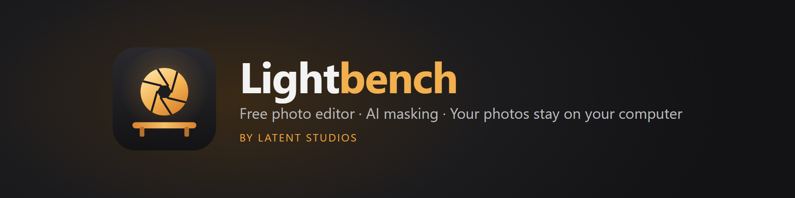
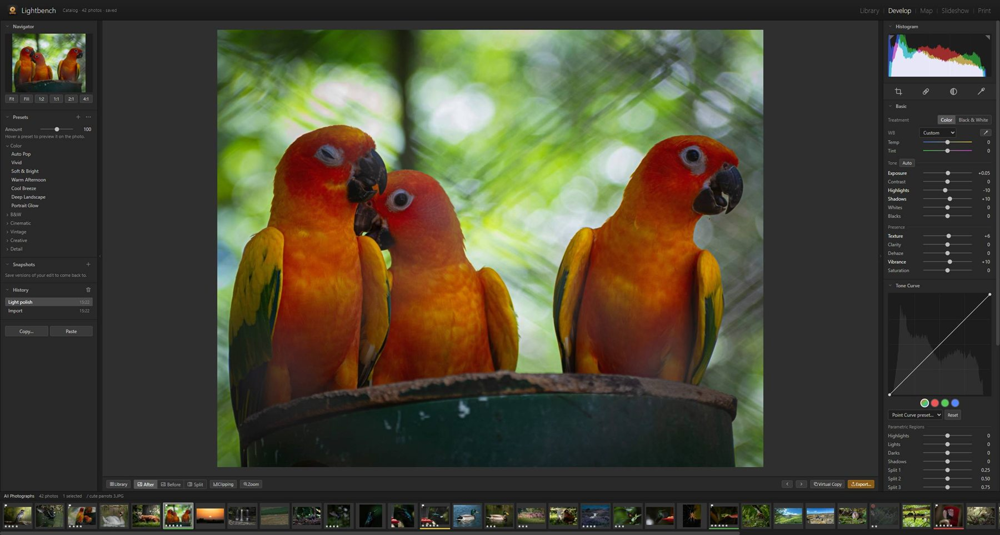
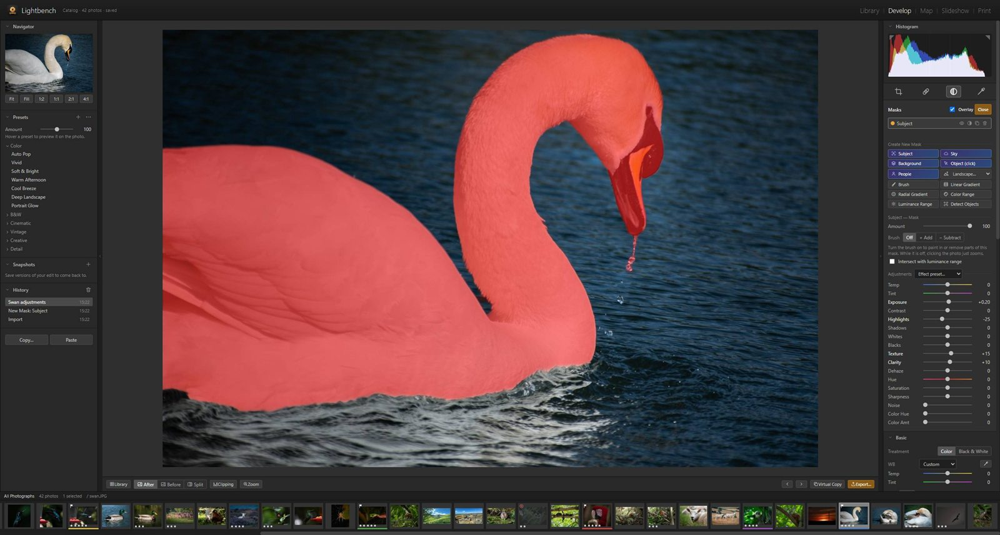
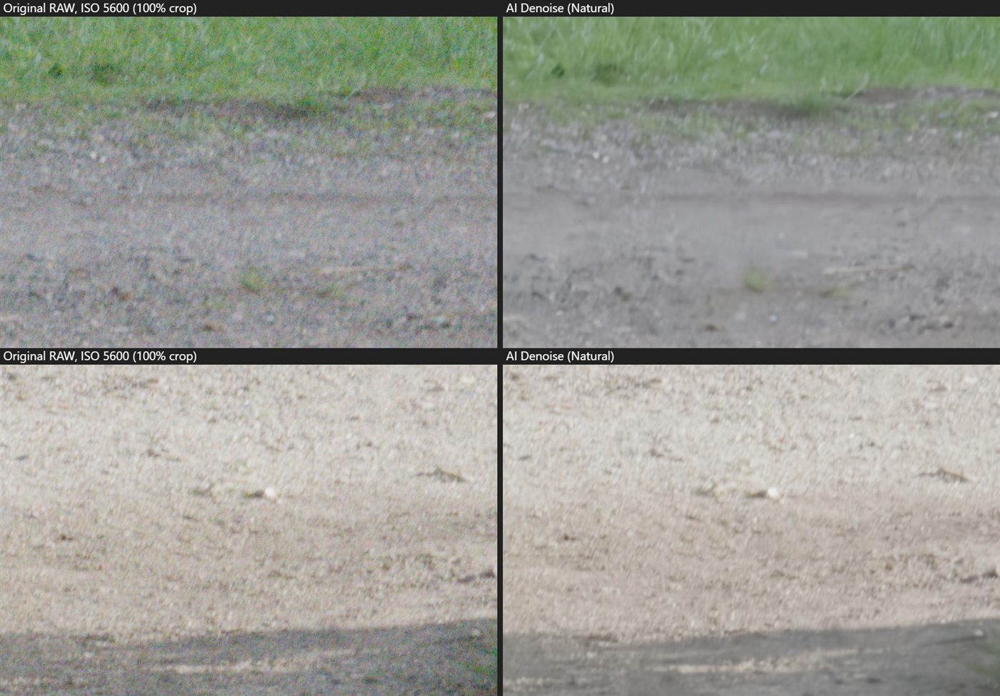
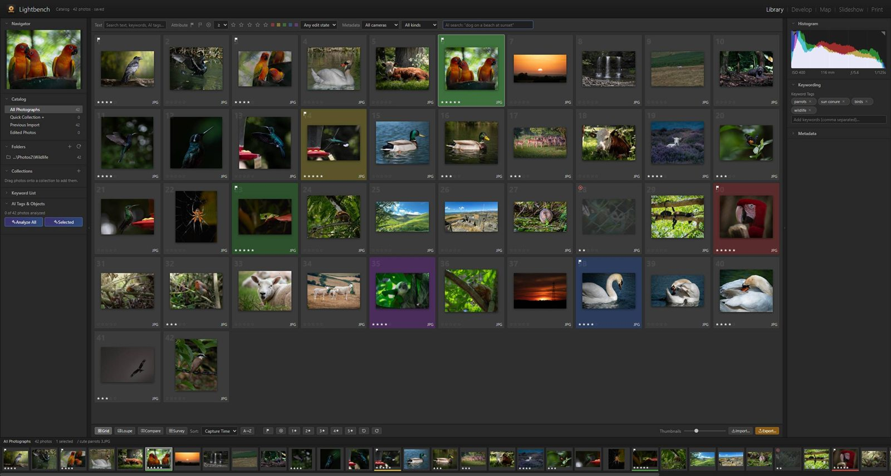
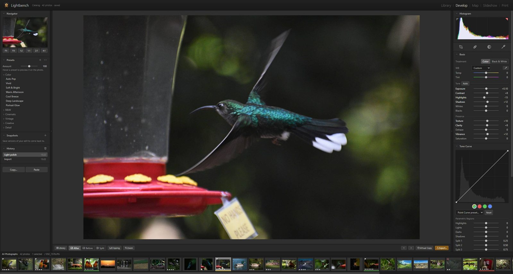

<p align="center">
  
</p>

<p align="center">
  <b>A photo library and RAW editor with one-click AI masking — for Windows and Mac.</b><br>
  Everything runs on your own computer. No account, no cloud, no subscription.
</p>

<p align="center">
  <a href="https://github.com/latentstudios/lightbench/releases/latest"></a>
  <a href="https://github.com/latentstudios/lightbench/releases"></a>
  <a href="https://discord.gg/QrBpnTrtP"></a>
  <a href="https://buymeacoffee.com/latentstudios"></a>
</p>

<h3 align="center">
  <a href="https://github.com/latentstudios/lightbench/releases/latest/download/Lightbench-Setup-win-x64.exe">⬇ Windows</a> &nbsp;·&nbsp;
  <a href="https://github.com/latentstudios/lightbench/releases/latest/download/Lightbench-mac-arm64.dmg">⬇ Mac (Apple silicon)</a> &nbsp;·&nbsp;
  <a href="https://github.com/latentstudios/lightbench/releases/latest/download/Lightbench-mac-x64.dmg">⬇ Mac (Intel)</a>
</h3>
<p align="center"><a href="https://latentstudios.github.io/lightbench/">Website</a> · <a href="#installing">Install help</a> · <a href="https://github.com/latentstudios/lightbench/releases">All versions</a></p>

<p align="center">
  
</p>

## What it does

| | |
|---|---|
| **True RAW editing** | 16-bit RAW decoding for Nikon, Canon, Sony, Fujifilm, Olympus, Panasonic, DNG and more — with real highlight and shadow recovery. |
| **One-click AI masks** | Select the **subject, sky, background, people** or landscape regions instantly — or click any object to select just that. |
| **AI Denoise** | Rescue high-ISO and low-light shots at full resolution, and dial the amount up or down any time. |
| **Search by description** | Type *“bird on a branch”* or *“sunset over water”* and Lightbench finds the photos — no tagging needed. |
| **Pro adjustments** | Tone curve, HSL, colour grading, clarity, dehaze, texture, healing, crop & straighten, lens corrections, grain, vignettes. |
| **Organise & cull fast** | Stars, picks, colour labels, keywords, smart collections, compare & survey views, keyboard-driven culling. |
| **Non-destructive** | Your originals are never changed. Undo history, snapshots, virtual copies, presets, copy/paste settings. |
| **Private & offline** | The AI runs on your own graphics card. After a one-time model download, every feature works offline. |

<table>
  <tr>
    <td width="50%"><br><sub><b>Select Subject</b> — one click, then adjust just the swan.</sub></td>
    <td width="50%"><br><sub><b>AI Denoise</b> — before / after on an ISO 5600 photo.</sub></td>
  </tr>
  <tr>
    <td width="50%"><br><sub><b>Library</b> — rate, flag and find the keepers in minutes.</sub></td>
    <td width="50%"><br><sub><b>Develop</b> — every slider updates live, even on 24 MP RAW files.</sub></td>
  </tr>
</table>

## Installing

**Windows 10 / 11 (64-bit):** download and run `Lightbench-Setup-win-x64.exe`.
If Windows shows *“Windows protected your PC”*, click **More info → Run anyway** — it appears because Lightbench is new and not yet code-signed.

**macOS 12 or later:** download the `.dmg` for your Mac (Apple menu → About This Mac → *Chip: Apple M…* = Apple silicon, *Processor: Intel* = Intel), and drag Lightbench into Applications.
The first time, open it, click **Done**, then go to **System Settings → Privacy & Security → Open Anyway**.
If macOS says it's *damaged*, run this in Terminal, then open it again:

```bash
xattr -cr /Applications/Lightbench.app && codesign --force --deep -s - /Applications/Lightbench.app
```

**Recommended:** 8 GB RAM and a graphics card with WebGPU support (most from 2016 onwards). On first launch Lightbench offers to download its AI models (about 600 MB, once).

Stuck? Ask in [#help on Discord](https://discord.gg/QrBpnTrtP) or [email us](mailto:latentstudios.hq@gmail.com).

## Help, feedback & community

- 💬 **Questions and install help:** [Discord](https://discord.gg/QrBpnTrtP) — also the place to show off your edits.
- 🐞 **Found a bug?** [Report it](https://github.com/latentstudios/lightbench/issues/new/choose), or use *Lightbench menu → Send Feedback* in the app (it fills in the technical details for you).
- 💡 **Ideas:** [suggest a feature](https://github.com/latentstudios/lightbench/issues/new/choose).
- ☕ **Support Lightbench:** [buy us a coffee](https://buymeacoffee.com/latentstudios) — it helps pay for code signing so Mac and Windows users don't see security warnings.

## Privacy

Your photos never leave your computer. There is no account, no analytics and no telemetry. Lightbench only goes online to download its AI models (once), to load map tiles in the Map module, and for an optional daily update check. Read the full [privacy notice](app/legal/PRIVACY.md).

## License

Lightbench is © 2026 Latent Studios. You may use it for personal and commercial photo work; see the [license agreement](LICENSE.txt). It's built on great open-source software and AI models — see the [credits](app/legal/THIRD_PARTY_NOTICES.md).

<details>
<summary><b>For developers</b></summary>

### Building
- `npm install` (then `node node_modules/electron/install.js` if npm skipped Electron's download)
- `npm start` — run from source
- `npm run dist:win` — Windows installer → `dist\Lightbench-Setup-win-x64.exe`
- `npm run dist:mac` — macOS disk images (must run on a Mac; the GitHub **Release** workflow does this automatically)

### Project layout
- `desktop.js` — Electron shell (window, menus, single instance) · `server.js` — local file, catalog and AI-model server
- `app/` — the UI and editing engine · `app/legal/` — license agreement, privacy notice, third-party notices
- `website/` — the product website (published by the **Website** workflow) · `.github/workflows/` — CI

### Where things live
- Catalog, previews, AI masks: `Pictures/Lightbench Library` (back this folder up to back up edits)
- AI models: the app's data folder (`%APPDATA%\Lightbench\models` on Windows)

### Licensing rules for contributions
Every bundled library and AI model permits commercial use. Before adding any new model or library, check its license; avoid "non-commercial", "research only", CC BY-NC, AGPL and model licenses with use restrictions.

### Releasing
See [PUBLISHING.md](PUBLISHING.md).
</details>
